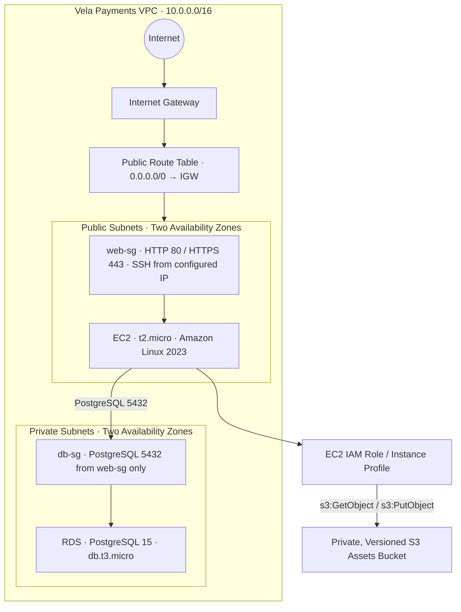

# Vela Payments Infrastructure

**Infrastructure as Code with Terraform and AWS**

I approached the Vela Payments challenge by translating the infrastructure requirements for a small-business fintech into a reproducible Terraform configuration. The goal is to make the required AWS infrastructure easier to review, maintain, and rebuild than manually configured resources.

I organized the solution around the networking, compute, database, and storage requirements for a simple two-tier web application: a custom VPC, a public EC2 instance, a private PostgreSQL RDS database, and a private S3 bucket for static assets.

I placed the Terraform configuration in `infra/` so the resources can be provisioned through code rather than recreated manually through the AWS Console.

---

## 1. Architecture

The architecture separates the public-facing web tier from the private database tier. Access to the database is restricted to the web server's security group, while access to the S3 assets bucket is controlled through the EC2 instance's IAM role.



### Architecture components

| Component | Configuration | Purpose |
|---|---|---|
| VPC | `10.0.0.0/16` | Provides an isolated network for the application infrastructure. |
| Public subnets | Two subnets in separate Availability Zones | Host the public-facing EC2 instance. |
| Private subnets | Two subnets in separate Availability Zones | Host the RDS database subnet group. |
| Internet Gateway | Attached to the custom VPC | Provides internet connectivity for resources in the public subnets. |
| Public route table | `0.0.0.0/0` routed through the Internet Gateway | Enables public-subnet internet routing. |
| EC2 instance | `t2.micro`, Amazon Linux 2023 | Represents the web tier. |
| `web-sg` | HTTP, HTTPS, restricted SSH and outbound traffic | Controls access to the EC2 instance. |
| RDS instance | PostgreSQL 15, `db.t3.micro` | Provides managed database infrastructure. |
| `db-sg` | PostgreSQL port 5432 from `web-sg` only | Restricts database access to the web tier. |
| IAM instance profile | EC2 role with restricted S3 permissions | Allows the EC2 instance to access application assets without static AWS credentials. |
| S3 assets bucket | Private, versioned bucket | Stores static application assets. |

The VPC networking, EC2 instance, and RDS database are deployed within the custom VPC. The S3 bucket is an AWS-managed service outside the VPC and is accessed through AWS APIs using IAM permissions.

All taggable infrastructure resources use the project tag:

```hcl
Project = "vela-payments"
```

The Terraform workspace is also used to identify the deployment environment through an environment tag.

---

## 2. Infrastructure Implementation

### Part 1 — Networking

I started the implementation by defining the networking foundation for the application.

I defined a custom VPC with the required CIDR block:

```text
10.0.0.0/16
```

Within the VPC, I specified:

- Two public subnets in separate Availability Zones.
- Two private subnets in separate Availability Zones.
- An Internet Gateway attached to the VPC.
- A public route table with a default route to the Internet Gateway.
- Route table associations for both public subnets.

I use the public subnets for the EC2 instance and the private subnets for the RDS subnet group.

The private subnets do not have a direct internet route. No NAT Gateway is provisioned because outbound internet access from the database subnets is not required for this challenge.

### Part 2 — Compute

For compute, I specified an EC2 instance and its associated security group.

**EC2 instance**

| Property | Configuration |
|---|---|
| Instance type | `t2.micro` |
| Operating system | Amazon Linux 2023 |
| Network placement | One public subnet |
| Security group | `web-sg` |
| IAM attachment | EC2 IAM instance profile |

**Web security group**

I configured `web-sg` with the following traffic rules:

| Direction | Protocol | Port | Source / Destination |
|---|---|---:|---|
| Inbound | TCP | 80 | `0.0.0.0/0` |
| Inbound | TCP | 443 | `0.0.0.0/0` |
| Inbound | TCP | 22 | Configurable SSH CIDR (`/32`) |
| Outbound | All | All | `0.0.0.0/0` |

SSH access is controlled through the `allowed_ssh_cidr` Terraform variable, rather than an unrestricted internet-facing rule.

**IAM instance profile**

I attached an IAM instance profile with a dedicated role to the EC2 instance. I restricted its permissions to:

- `s3:GetObject`
- `s3:PutObject`

I scoped these permissions to objects within the configured application assets bucket.

This lets the EC2 instance interact with S3 without embedding AWS access keys in application files or the Terraform configuration.

### Part 3 — Database

For the database layer, I specified Amazon RDS with PostgreSQL.

| Property | Configuration |
|---|---|
| Service | Amazon RDS |
| Engine | PostgreSQL |
| Engine version | 15 |
| Instance class | `db.t3.micro` |
| Subnet group | Private subnets across two Availability Zones |
| Public accessibility | Disabled |
| Security group | `db-sg` |
| Port | 5432 |

I configured `db-sg` to allow inbound PostgreSQL traffic only from `web-sg`.

The RDS instance is configured with:

```hcl
publicly_accessible = false
```

I pass database credentials through Terraform variables. The username and password have no default values, and I mark the variables as sensitive.

This design keeps the database from being directly exposed to the public internet and limits database connectivity to the web tier.

### Part 4 — Storage

For storage, I specified a dedicated S3 bucket for static application assets.

I configured the bucket with:

- A name supplied through the `s3_bucket_name` Terraform variable.
- Bucket versioning enabled.
- All four S3 Block Public Access settings enabled.
- A bucket policy restricting object reads and writes to the intended EC2 IAM role.

I grant the IAM role only `s3:GetObject` and `s3:PutObject` permissions on objects in this bucket. No public access is required.

I keep the application assets bucket separate from the S3 bucket used for Terraform remote state.

### Part 5 — Variables, Outputs and Remote State

I separated deployment-specific values from the infrastructure definitions.

**Terraform variables**

I made the following values configurable through `variables.tf`:

| Variable | Type | Default | Description |
|---|---|---|---|
| `aws_region` | `string` | Required | AWS region used for the deployment. |
| `vpc_cidr` | `string` | `10.0.0.0/16` | CIDR block assigned to the custom VPC. |
| `public_subnet_cidrs` | `list(string)` | `["10.0.1.0/24", "10.0.2.0/24"]` | CIDR blocks for the two public subnets. |
| `private_subnet_cidrs` | `list(string)` | `["10.0.11.0/24", "10.0.12.0/24"]` | CIDR blocks for the two private subnets. |
| `allowed_ssh_cidr` | `string` | Required | Public IPv4 address allowed to connect through SSH, in `/32` notation. |
| `db_username` | `string` | Required | RDS master username. Marked sensitive. |
| `db_password` | `string` | Required | RDS master password. Marked sensitive. |
| `s3_bucket_name` | `string` | Required | Globally unique name for the application assets bucket. |

I require exactly two entries in each subnet CIDR variable. The deployer supplies the sensitive database credentials and SSH CIDR.

I included `example.tfvars` to demonstrate the required variable configuration. Its credentials and documentation-only SSH address are examples, not deployment values. Because S3 bucket names are globally unique, I also replace the sample assets bucket name with a name available to my AWS account before deployment. I keep real credentials and my personal IP address in a local ignored tfvars file.

**Terraform outputs**

I exposed the following outputs through `outputs.tf`:

| Output | Description |
|---|---|
| `ec2_public_ip` | Public IP address of the EC2 instance. |
| `rds_endpoint` | RDS PostgreSQL connection endpoint. |
| `s3_bucket_name` | Name of the application assets bucket. |

**Remote state**

I configured Terraform to store state remotely using the S3 backend.

The backend configuration uses the key:

```text
vela-payments/terraform.tfstate
```

I require the backend bucket to be created manually before Terraform initialization. It is separate from the application assets bucket and should have public access blocked and versioning enabled.

I enabled encryption in the S3 backend configuration. I pass the bucket name and region during initialization because Terraform backend configuration cannot reference ordinary input variables.

---

## 3. Repository Setup

### Prerequisites

Before running the configuration, I need:

- Terraform version 1.5 or later.
- AWS CLI installed and configured.
- AWS credentials with permission to manage the required AWS resources.
- An S3 bucket for Terraform remote state, created before initialization.
- An AWS region with at least two available Availability Zones.

I keep all Terraform configuration files in the `infra/` directory.

### Configure AWS credentials

I provide AWS credentials through an AWS CLI profile or standard AWS credential environment variables.

For example, using PowerShell:

```powershell
aws configure --profile vela
$env:AWS_PROFILE = "vela"
```

I keep credentials outside the Terraform source files and do not commit them to the repository.

### Create the Terraform backend bucket

I create the S3 bucket used for Terraform state before running `terraform init`.

I create a dedicated general-purpose S3 bucket in the intended AWS region and configure it with:

- A globally unique bucket name.
- Block all public access enabled.
- Bucket versioning enabled.
- Encryption at rest enabled.
- Access restricted to the AWS identities that need to manage Terraform state.

I use a separate bucket for Terraform state rather than reusing the application assets bucket.

### Configure deployment variables

I use the repository's `example.tfvars` as a template containing example configuration values. I replace the sample assets bucket name with one that is globally unique and available before deployment.

I copy the file to a local `terraform.tfvars` file in the repository root and replace its example values with the deployment settings.

For example, using PowerShell:

```powershell
Copy-Item example.tfvars terraform.tfvars
```

I configure:

- `aws_region` with the target AWS region.
- `allowed_ssh_cidr` with your public IP in `/32` notation.
- `db_username` and `db_password` with the desired database credentials.
- `s3_bucket_name` with a globally unique application assets bucket name.

Real `.tfvars` files are excluded through `.gitignore`. I keep the committed `example.tfvars` as an example and do not put real deployment credentials or personal IP addresses in it.

### Initialize Terraform

From the repository root, I change into the Terraform configuration directory:

```powershell
cd infra
```

I initialize the S3 backend using the bucket created previously:

```powershell
terraform init `
  -backend-config="bucket=<your-terraform-state-bucket>" `
  -backend-config="region=<your-aws-region>"
```

The backend bucket name and region must match the bucket created for this deployment.

### Format, validate and plan

From the `infra/` directory, I can run the following formatting, validation, and plan commands:

```powershell
terraform fmt -check -recursive
terraform validate

terraform plan -var-file="../example.tfvars"
```

For a deployment using your own values:

```powershell
terraform plan -var-file="../terraform.tfvars"
```

If the plan command completes successfully, Terraform displays the resources it would create, modify, or destroy.

I review the plan before applying any changes. The challenge requires a successful plan; it does not require me to deploy live infrastructure for submission.

**Note:** Because the S3 backend needs an existing bucket, initialization requires its bucket and region settings. A plain `terraform init` works only when those backend settings have already been supplied or configured.

---

## 4. Design Decisions

### Private database deployment

I specified the RDS instance in private subnets and set `publicly_accessible = false`.

I configured its security group to accept PostgreSQL traffic only from the web security group. This reduces the database's exposure and restricts database connections to the intended application tier.

### IAM roles instead of static AWS credentials

I attached an IAM instance profile to the EC2 instance to provide AWS permissions.

I limited the role to `s3:GetObject` and `s3:PutObject` on the configured assets bucket. This avoids storing long-lived AWS access keys on the instance and follows the principle of least privilege.

### Restricted SSH access

I configured the web security group to accept SSH traffic only from a configurable `/32` CIDR.

I used a Terraform variable so the configuration does not hardcode a personal IP address or allow SSH connections from the entire internet.

### Separate application and Terraform state storage

I use the application assets bucket and Terraform backend bucket for different purposes.

Terraform manages the assets bucket for application files. The backend bucket stores Terraform state and is created separately before initialization.

I keep these resources separate to avoid mixing application data with infrastructure state.

### No NAT Gateway

The private database subnets do not require outbound internet connectivity for this challenge.

For that reason, I did not include a NAT Gateway, avoiding an additional infrastructure component and its associated costs.

---

## 5. Staging and Production Workspaces

As an optional extension, I configured support for separate staging and production environments through Terraform workspaces.

Each workspace maintains a separate Terraform state while reusing the same infrastructure configuration.

I applied workspace-specific naming to resources that require unique identifiers, including the RDS instance, database subnet group, and EC2 IAM role and instance profile. I also tag resources with the active workspace as their environment.

Each environment must use a different globally unique S3 assets bucket name.

From the `infra/` directory, create the staging workspace:

```powershell
terraform workspace new staging

terraform plan -var-file="../example.tfvars" `
  -var="s3_bucket_name=<globally-unique-staging-bucket>"
```

Then create the production workspace:

```powershell
terraform workspace new production

terraform plan -var-file="../example.tfvars" `
  -var="s3_bucket_name=<globally-unique-production-bucket>"
```

To confirm the active workspace:

```powershell
terraform workspace show
```

Before applying or destroying resources, verify the selected workspace and the corresponding environment-specific variable values.

The S3 backend uses `vela-payments/terraform.tfstate` as the default workspace key. Non-default workspaces use the backend's workspace key prefix, allowing Terraform to maintain separate state files.

Workspaces provide state separation, but they should not be treated as independent security boundaries.

---

## 6. Verification and Cleanup

I can check the configuration using:

```powershell
terraform fmt -check -recursive
terraform validate
terraform plan -var-file="../example.tfvars"
```

When a plan completes successfully, it confirms that Terraform can parse the configuration, validate the resource definitions, resolve the required inputs, and generate an execution plan.

No `terraform apply` is required for the challenge submission.

Creating EC2 and RDS resources may incur AWS charges. When an environment is no longer needed, select the correct workspace and use the corresponding deployment variables before running:

```powershell
terraform workspace show
terraform destroy -var-file="../terraform.tfvars"
```

The manually created Terraform backend bucket is separate from the resources managed by this configuration and is not removed by the normal infrastructure cleanup.

---

## 7. Project Outcome

Through this implementation, I expressed the infrastructure required by the Vela Payments challenge as Terraform configuration:

- A custom VPC with two public and two private subnets across separate Availability Zones.
- An Internet Gateway and public routing.
- A public Amazon Linux 2023 EC2 instance with restricted SSH access.
- An EC2 IAM instance profile with limited S3 object permissions.
- A private PostgreSQL 15 RDS instance accessible only from the web security group.
- A private, versioned S3 bucket for static assets.
- Configurable input variables, documented outputs, and encrypted remote state.
- Optional staging and production workspace support.

I used infrastructure as code to make the environment easier to review, reproduce, and manage without relying on undocumented manual configuration in the AWS Console.
