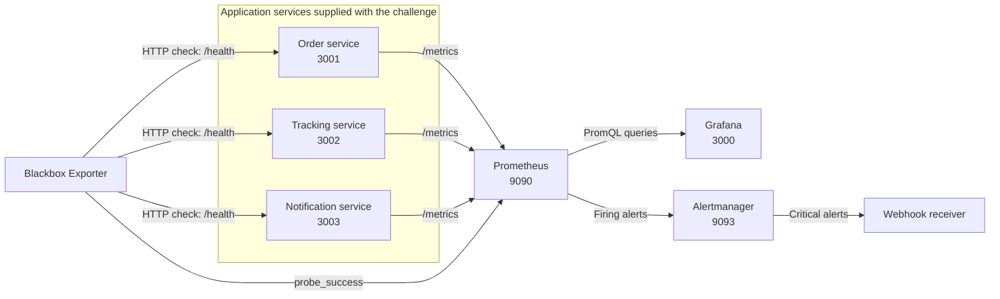
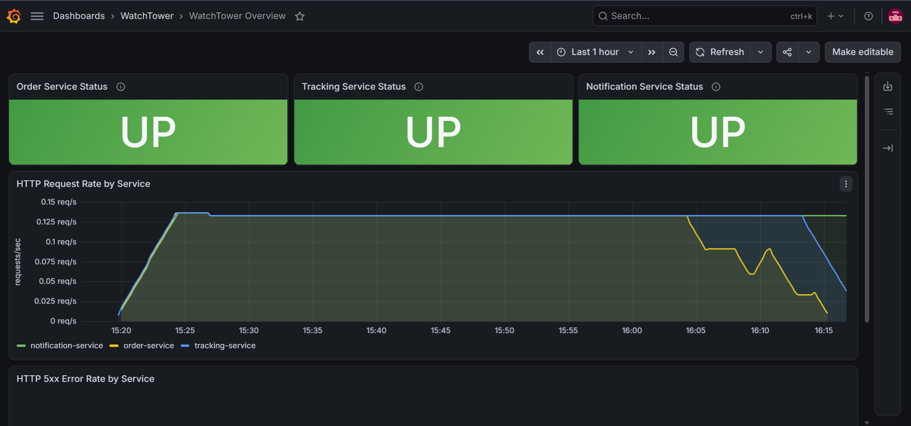
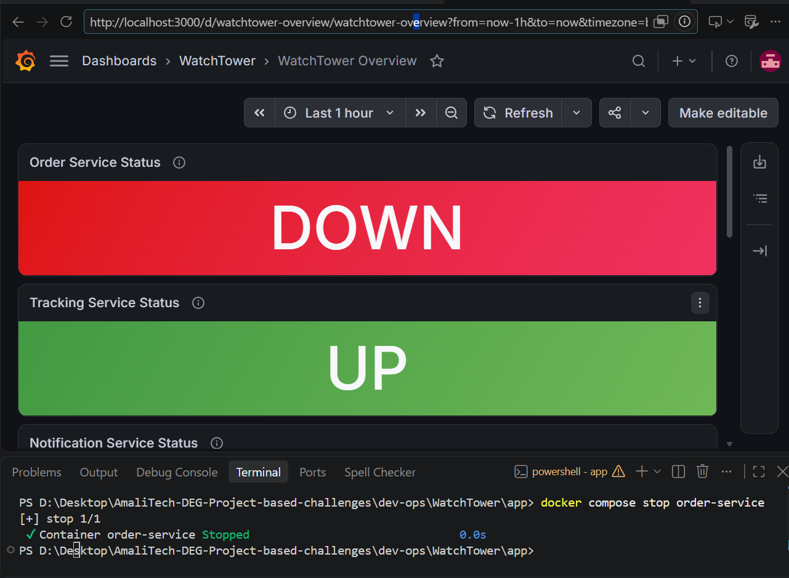

# WatchTower — Service Monitoring and Observability

## Overview

I set up WatchTower as a local observability environment for the three Reyla Logistics backend services supplied with the challenge: `order-service`, `tracking-service`, and `notification-service`.

I used Docker Compose to run the environment and connected the following tools to monitor service availability and application metrics, view the information in Grafana, and route critical alerts through Alertmanager:

- **Prometheus** to collect metrics from the three application services.
- **Blackbox Exporter** to check each service's HTTP `/health` endpoint.
- **Grafana** to display service status, request rates, and HTTP 5xx error rates.
- **Alertmanager** to receive Prometheus alerts and route critical alerts to a local webhook receiver.
- **Docker JSON logging** to collect container output and rotate log files.

## Architecture



I placed the containers on a shared Docker network. This allows the monitoring containers to reach the application services by their Compose service names. I also used environment variables for the service names and ports, with `.env.example` provided as the configuration template.

## Repository layout

The main configuration files I added or configured are:

```text
WatchTower/
├── app/
│   ├── docker-compose.yml
│   ├── .env.example
│   ├── prometheus.yml
│   ├── prometheus/
│   │   ├── alerts.yml
│   │   ├── alerts.test.yml
│   │   └── config-renderer/
│   │       ├── Dockerfile
│   │       └── render-config.js
│   ├── grafana/
│   │   ├── dashboards/
│   │   │   └── watchtower-overview.json
│   │   └── provisioning/
│   ├── alertmanager/
│   │   └── alertmanager.yml
│   └── docs/
│       ├── watchtower-dashboard.png
│       └── order-service-down-test.png
```

The three application services are part of the supplied challenge files under `app/`; the configuration above is the observability setup I added around them.

## Running the environment

### Requirements

- Docker
- Docker Compose v2
- `jq` (optional; only needed for the log-filtering command)

### Start the containers

From the repository root, I run:

```bash
cd dev-ops/WatchTower/app
cp .env.example .env
docker compose up --build -d
docker compose ps
```

In PowerShell, I copy the environment template with:

```powershell
Copy-Item .env.example .env
```

The `.env` file contains the service names and ports used by Compose and Prometheus. A small one-shot config-renderer container substitutes these values into `prometheus.yml` before Prometheus starts, because Prometheus itself does not expand environment variables in its configuration. I keep the local `.env` out of Git and commit `.env.example` instead.

### Local addresses

| Component | Address | What I use it for |
|---|---|---|
| Order service | <http://localhost:3001> | Order application |
| Tracking service | <http://localhost:3002> | Tracking application |
| Notification service | <http://localhost:3003> | Notification application |
| Prometheus | <http://localhost:9090> | Metrics and alert rules |
| Prometheus targets | <http://localhost:9090/targets> | Inspect scrape target status |
| Prometheus alerts | <http://localhost:9090/alerts> | Inspect alert states |
| Grafana | <http://localhost:3000> | Open the WatchTower dashboard |
| Alertmanager | <http://localhost:9093> | Inspect received alerts |

The application health endpoints are `/health` on ports 3001, 3002, and 3003. When a service is healthy, its endpoint returns a JSON response with `"status":"ok"`.

For the initial Grafana login, the configured default credentials are `admin` / `admin`. Grafana may ask me to change the password after signing in.

### Startup verification

I started the Compose stack and checked its containers and endpoints. The three application `/health` endpoints and Grafana's health endpoint returned HTTP 200. Prometheus's health endpoint also returned HTTP 200, and its targets API reported all three application metrics targets and all three Blackbox health probes as `UP`. Prometheus's alerts API returned an empty alert list while the services were healthy.

## Prometheus metrics and health checks

I configured Prometheus to scrape the `/metrics` endpoint of each application service every **15 seconds**. The template is in `app/prometheus.yml`; Compose passes the `.env` values to the config-renderer, which renders the final configuration into a shared volume before Prometheus starts.

I also configured Blackbox Exporter to send HTTP probes to each application's `/health` endpoint. Prometheus collects the resulting `probe_success` metric. These checks give me two separate views of the services:

- The application metrics target indicates whether Prometheus can scrape `/metrics`.
- The Blackbox probe indicates whether the service responds successfully to an HTTP health check.

I can inspect the scrape targets at <http://localhost:9090/targets>. The three application metrics targets should show `UP` while Prometheus can successfully scrape them.

## Grafana dashboard

I configured Grafana to use Prometheus as its data source. I also set up Grafana provisioning so the dashboard is loaded automatically when Grafana starts; it does not need to be imported manually.

The dashboard configuration is stored in:

- `app/grafana/dashboards/watchtower-overview.json`
- `app/grafana/provisioning/`

The dashboard is named **WatchTower Overview** and contains five panels:

1. **Order Service Status** — displays the result of the Order service's `/health` probe.
2. **Tracking Service Status** — displays the result of the Tracking service's `/health` probe.
3. **Notification Service Status** — displays the result of the Notification service's `/health` probe.
4. **HTTP Request Rate by Service** — plots the request rate for each service using a five-minute rate window.
5. **HTTP 5xx Error Rate by Service** — displays the percentage of HTTP 5xx responses relative to total requests for each service, also using a five-minute rate window.

### Dashboard while services are running

I started the stack and opened the provisioned dashboard in Grafana. In this capture, all three service status panels display **UP**, and the request-rate panel shows data for the three services.



## Prometheus alert rules

I added the alert rules in `app/prometheus/alerts.yml` and configured Prometheus to load them through `app/prometheus.yml`. Each rule includes a human-readable `summary` and `description` annotation.

| Alert | Condition | Severity |
|---|---|---|
| `ServiceDown` | A service's `/health` probe returns a non-200 result for more than 1 minute | `critical` |
| `HighErrorRate` | More than 5% of requests return HTTP 5xx responses over a 5-minute window | `warning` |
| `ServiceNotScraping` | Prometheus cannot scrape a service's `/metrics` endpoint for more than 2 minutes | `warning` |

### Rule test configuration

I included a `promtool` test file with synthetic samples for the three alert conditions. With the stack running, I can execute the test from the `app/` directory using:

```bash
docker compose exec prometheus promtool test rules /etc/prometheus/alerts.test.yml
```

I ran the rule test in the Prometheus container. It returned `SUCCESS`. The test cases cover a failed health probe for `ServiceDown`, a 5xx rate above 5% for `HighErrorRate`, and a failed metrics scrape for `ServiceNotScraping`. This verifies the alert rules against synthetic samples; it does not replace checking a live outage.

### Checking a service failure

I checked the dashboard and alert behavior during a stopped-service test. From the `app/` directory, I ran:

```bash
docker compose stop order-service
```

The terminal confirmed that the `order-service` container stopped. The Grafana capture shows the Order Service Status panel changing to **DOWN**, while the Tracking Service Status panel remains **UP**.



This confirms that the dashboard reflects the failed Order service health check. During a separate live check, I left the service stopped for 140 seconds and queried Prometheus and Alertmanager:

- `ServiceDown` fired after the `/health` probe remained failed for over 1 minute.
- `ServiceNotScraping` fired after Prometheus could not scrape `/metrics` for over 2 minutes.
- Alertmanager showed the critical `ServiceDown` alert, and the receiver logs contained its notification.

I then restarted the service:

```bash
docker compose start order-service
```

After recovery, the Order service's `/health` endpoint returned HTTP 200, and a later Prometheus alert check showed neither outage alert firing.

The supplied services do not include a route intended to return HTTP 5xx responses. I therefore included synthetic test data for `HighErrorRate` rather than claiming to have triggered it using live application traffic.

## Structured logging

I configured the Compose containers to use Docker's `json-file` logging driver, with rotation limited to **three 10 MB files per container**.

To follow the output from all containers, I run:

```bash
docker compose logs --follow --no-color --no-log-prefix
```

To filter the Order service's JSON application logs for error-level records, I use `jq`:

```bash
docker compose logs --follow --no-color --no-log-prefix order-service |
  jq -c 'select(.level == "error")'
```

Docker Compose outputs each application log as a JSON object, so the filter selects the `level` field directly. I verified that it selects an error-level JSON record; the current service logs are informational, so filtering the recent logs produced no matches.

An example of the expected filtered record is:

```json
{"level":"error","service":"order-service","msg":"example error"}
```

The supplied application services currently emit informational JSON logs. The filter will therefore display a record only when an error-level log is produced.

I verified that `docker compose logs` displays the services' JSON application records and confirmed the JSON logging driver and rotation settings in the resolved Compose configuration. I installed `jq` 1.8.2 and tested the filter: a synthetic error-level record was selected, while recent service logs produced no matches because they contain only informational records.

## Alertmanager integration

For the bonus part, I configured Alertmanager to route alerts with the `critical` severity to an internal `alert-receiver` webhook service. Prometheus forwards firing alerts to Alertmanager, and warning alerts are not routed to this receiver.

The receiver logs selected alert details as JSON: the alert status, alert name, affected service, and summary. It remains on the internal Docker network, does not expose a host port, and does not log the full alert payload. The Alertmanager interface is available at <http://localhost:9093>.

This receiver is a local demonstration endpoint, not an external paging or email service. I verified that Alertmanager delivered the critical `ServiceDown` notification to it during the live outage test. A production integration would use an organization-managed, authenticated HTTPS webhook. Credentials and tokens should not be committed to the repository.

## Stopping the environment

From the `app/` directory, I stop and remove the containers and network with:

```bash
docker compose down
```

## Implementation summary

The observability environment I configured includes:

- A Docker Compose setup for the provided application services and monitoring components.
- Prometheus scraping the three `/metrics` endpoints every 15 seconds.
- Blackbox Exporter probes for the three `/health` endpoints.
- A provisioned Grafana dashboard with service status, request-rate, and 5xx error-rate panels.
- Three Prometheus alert rules with summaries and descriptions.
- Docker JSON logging with file rotation and commands for viewing and filtering application logs.
- An Alertmanager route for critical alerts to an internal webhook receiver.

The screenshots document the dashboard with all three services healthy and the dashboard response when the Order service is stopped. The synthetic `promtool` rule test passed, all six Prometheus targets were up during startup verification, and the live `ServiceDown` and `ServiceNotScraping` alerts fired during the outage check. Alertmanager delivered the critical notification to the local receiver.
